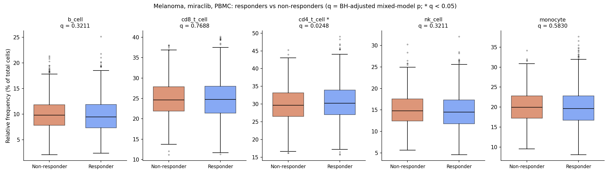

# miraclib-response-analysis

Analysis of immune cell populations in Loblaw Bio's clinical trial (`cell-count.csv`):
a SQLite database (Part 1), per-sample cell-population frequencies (Part 2), a
responder vs non-responder comparison for melanoma patients on miraclib (Part 3), and
a baseline subset query (Part 4), all shown in an interactive Streamlit dashboard.

## Quick start (GitHub Codespaces or any machine with Python 3.10+)

```bash
make setup      # pip install -r requirements.txt
make pipeline   # build cell_counts.db and write every result to outputs/
make dashboard  # start the dashboard on port 8501
```

**Dashboard link:** <http://localhost:8501>

In Codespaces, port 8501 is forwarded automatically. Open it from the **Ports**
tab, or follow the "Open in Browser" prompt. `make dashboard` reads from the
database that `make pipeline` creates, so run the pipeline first.

You can also run the steps individually: `python load_data.py` builds only the
database, and `python run_pipeline.py` runs Parts 1–4 end to end.

## Repository layout

| File | Purpose |
|---|---|
| `load_data.py` | Part 1. Creates the schema and loads every row of `cell-count.csv` into `cell_counts.db`. |
| `analysis.py` | SQL queries and statistics for Parts 2–4. The pipeline and the dashboard share it. |
| `run_pipeline.py` | Runs Parts 1–4 in order and writes the results to `outputs/`. |
| `dashboard.py` | Streamlit dashboard, with one tab each for Parts 2, 3 and 4. |
| `Makefile` | `setup`, `pipeline` and `dashboard` targets, plus `clean`. |
| `outputs/` | Generated CSV tables and the Part 3 boxplot. |

## Part 1: Database schema

The data is normalized so that each fact is stored once:

```
projects(project_id PK)
   │ 1..n
subjects(subject_id PK, project_id FK, condition, age, sex, treatment, response)
   │ 1..n
samples(sample_id PK, subject_id FK, sample_type, time_from_treatment_start)
   │ 1..n
cell_counts(sample_id FK, population_id FK, count)   PK(sample_id, population_id)
   │ n..1
cell_populations(population_id PK, name UNIQUE)
```

**Rationale**

- **Subject vs sample.** Condition, age, sex, treatment and response belong to
  the patient and do not change across that patient's samples. Storing them once
  in `subjects` avoids repeating them on every sample row and prevents
  inconsistent values. The loader checks that these fields agree across a
  subject's rows and raises an error if they do not. Each sample's type and
  timepoint live in `samples`.
- **Long-format counts.** `cell_counts` stores one row per (sample, population),
  with population names in a lookup table. A new population (for example, a new
  panel marker) is just new rows, with no `ALTER TABLE` and no changes to the
  queries. Part 2's long-format output also falls straight out of a `GROUP BY`.
- **Scaling.** With hundreds of projects and thousands of samples, the design
  stays the same. Indexes on the common filter columns (condition, treatment,
  response, sample type, timepoint) and on the foreign keys keep the cohort
  queries fast. Constraints (`CHECK` on sex, response and count; `NOT NULL`;
  foreign keys) reject bad data at load time. New sample-level or subject-level
  metadata becomes new columns or tables without touching the counts table.
  For much larger data, the same schema ports directly to PostgreSQL.

## Part 2: Frequency table

`analysis.frequency_table()` computes each sample's total count with SQL and
then the share of each population, returning these columns:
`sample, total_count, population, count, percentage`. The output has
52,500 rows (10,500 samples × 5 populations) and is saved to
`outputs/part2_frequency_table.csv`. The dashboard shows it with filters and a
download button.

## Part 3: Responders vs non-responders

**Cohort:** melanoma patients treated with miraclib, PBMC samples only. That is
1,968 samples from 656 subjects (331 responders and 325 non-responders), each
sampled at days 0, 7 and 14.

**Statistical approach**

- Each subject contributes 3 samples, so the samples are not independent.
  Treating them as independent would overstate the sample size. The primary
  test is therefore a **linear mixed model** per population:
  `percentage ~ response + C(timepoint) + (1 | subject)`. It has a random
  intercept per subject and adjusts for timepoint.
- Five populations are tested, so p-values are corrected with
  **Benjamini–Hochberg FDR**. A population counts as significant if q < 0.05.
- Two non-parametric checks that make no normality assumption are also
  reported: Mann–Whitney U on all samples, and Mann–Whitney U on per-subject
  mean frequencies (one value per subject). Rank-biserial correlation is given
  as an effect size.
- Per-timepoint Mann–Whitney tests (`outputs/part3_responder_stats_by_timepoint.csv`)
  show when any difference appears.

**Results** (`outputs/part3_responder_stats.csv`, `outputs/part3_boxplot.png`)

| population | responder mean % | non-responder mean % | difference (pp) [95% CI] | mixed-model p | **q (BH)** | MWU p (samples) | MWU p (subjects) |
|---|---|---|---|---|---|---|---|
| b_cell | 9.80 | 10.00 | −0.20 [−0.48, 0.09] | 0.171 | 0.321 | 0.056 | 0.346 |
| cd8_t_cell | 24.88 | 24.94 | −0.06 [−0.48, 0.35] | 0.769 | 0.769 | 0.639 | 0.622 |
| **cd4_t_cell** | **30.54** | **29.90** | **+0.64 [0.19, 1.08]** | **0.005** | **0.025** | **0.013** | **0.012** |
| nk_cell | 14.84 | 15.07 | −0.23 [−0.58, 0.12] | 0.193 | 0.321 | 0.121 | 0.127 |
| monocyte | 19.94 | 20.08 | −0.14 [−0.53, 0.24] | 0.466 | 0.583 | 0.163 | 0.265 |



**Conclusion.** **CD4⁺ T cells** are the only population with a significant
difference. Responders have a higher CD4⁺ T-cell frequency than non-responders:
+0.64 percentage points (95% CI 0.19–1.08), mixed-model p = 0.005,
FDR q = 0.025. Both Mann–Whitney tests agree in direction and are nominally
significant (p ≈ 0.01). Neither survives FDR on its own (q ≈ 0.06–0.07),
because these tests do not use the repeated-measures structure. B cells,
CD8⁺ T cells, NK cells and monocytes show no significant difference.

Points to keep in mind when presenting this result:

- **The effect is small.** The shift is about 0.6 percentage points on a base
  of about 30%, and the rank-biserial effect size is about 0.06. The two
  distributions overlap heavily, so CD4⁺ frequency alone would be a weak
  classifier of response.
- **It is not a baseline predictor.** At day 0 responders and non-responders
  are indistinguishable (p = 0.80). The CD4⁺ difference appears on treatment
  (day 7 p = 0.03, day 14 p = 0.08, both nominal). This points to a
  pharmacodynamic signal linked to response rather than a pre-treatment
  predictive biomarker. Confirming either would need an independent cohort.

## Part 4: Baseline subset

Query: melanoma, PBMC, `time_from_treatment_start = 0`, treatment = miraclib.
The SQL lives in `analysis.py`; the results are in `outputs/part4_*.csv` and on
the dashboard's Part 4 tab.

- **656 samples** (one per subject).
- **Samples per project:** prj1 = 384, prj3 = 272, prj2 = 0 (prj2 collected
  only whole-blood samples).
- **Subjects by response:** 331 responders, 325 non-responders.
- **Subjects by sex:** 344 male, 312 female.
